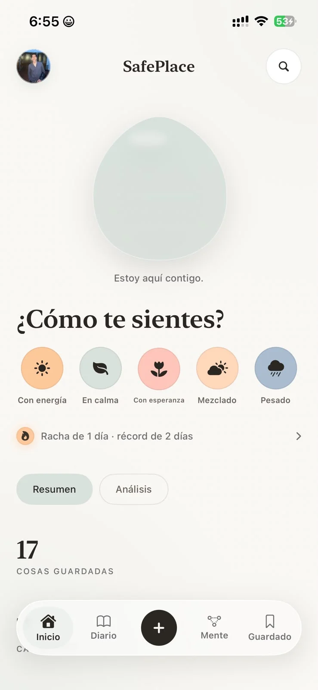

# Landing de SafePlace

Página de presentación de la app, servida por GitHub Pages junto al feed de
AltSource. Hereda el sistema visual de la app (`../DESIGN.md`): papel cálido,
serif de display, un único acento que cambia con el estado de ánimo.

## Archivos

| Archivo | Qué es |
| --- | --- |
| `index.html` | Landing en español (por defecto) |
| `en.html` | Landing en inglés |
| `landing.css` | Tokens y componentes compartidos. Sin build step |
| `assets/hero-wide.webp` | Ilustración del hero (1672×941) |
| `assets/scene-1.webp` | Escena del tren (1672×941) |
| `assets/scene-3.webp` | Escena de la cama (1200 px) |
| `assets/band-kitchen.webp` | Banda de la cocina (1914×822) |
| `assets/shot-home.webp` | Captura real de la pantalla de inicio (739×1600) |
| `assets/shot-journal.webp` | Captura real del diario (739×1600) |
| `assets/shot-mind.webp` | Captura real de Mente (739×1600) |
| `assets/og.png` | Imagen para compartir (1200×630) |
| `icon.png` | Icono de la app. **Copia de `AppIcon-1024.png`**: no editar aquí |
| `source.json` | Feed AltSource. **Lo regenera el CI en cada release** |

El workflow publica toda la carpeta `docs/`, así que la landing y el feed viven
en el mismo dominio: `https://hihirams.github.io/SafePlace-App/`.

## Cambiar las capturas de la app

La sección **Tres pantallas** usa capturas reales de la app, ya en proporción
9:19.5. Para reemplazarlas, en `index.html` y `en.html` busca `shot-home.webp`,
`shot-journal.webp` y `shot-mind.webp`.

Cada una es esto:

```html

```

Exporta desde el simulador o el iPhone a 1179×2556 (iPhone 15 Pro) o equivalente,
convierte a WebP y actualiza `width`, `height` y el `alt`. El marco recorta lo que
sobre, pero mantén la proporción 9:19.5 para que no se deforme.

En móvil el carrusel **no usa scroll horizontal nativo**: un visor con
`overflow:hidden` recorta un riel que se mueve por `transform`, y las flechas
cambian de diapositiva. Si le devuelves `overflow-x:auto`, el gesto horizontal
vuelve a competir con el scroll vertical de la página.

## Probar en local

```bash
npx serve docs
# o
python -m http.server 8100 --directory docs
```

Abre `http://localhost:8100/`. Con `file://` funciona todo menos la lectura de
`source.json` (la versión cae al valor por defecto).

## Reglas que no se negocian

- Un solo acento; el color va en el detalle, nunca en el fondo.
- Sin tarjetas anidadas, sin sombras decorativas, sin degradados fuertes.
- El papel `#FAF8F4` es el token `canvas` de la app: no es un beige genérico.
  El detector de Impeccable lo marca como patrón por defecto; está desactivado
  con razón escrita en el `<head>`.
- Todo el texto vive en HTML, no dentro de las imágenes.
